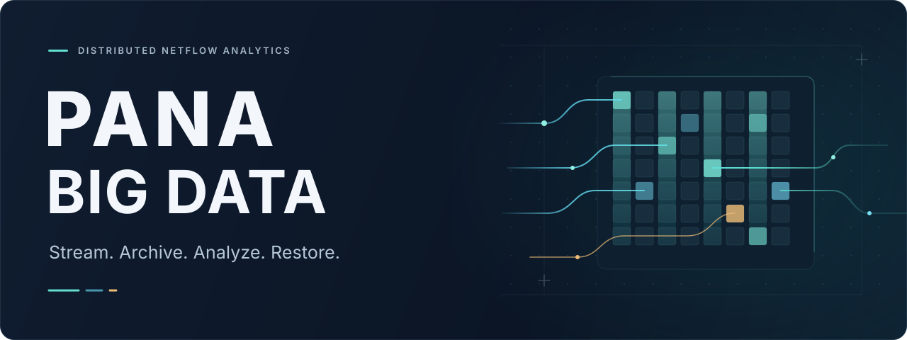
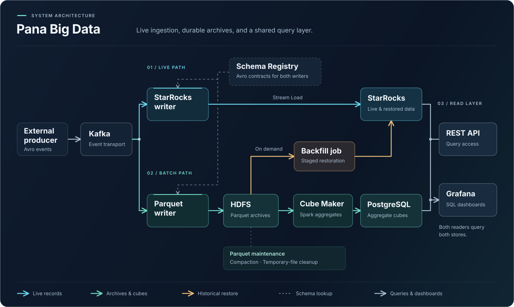
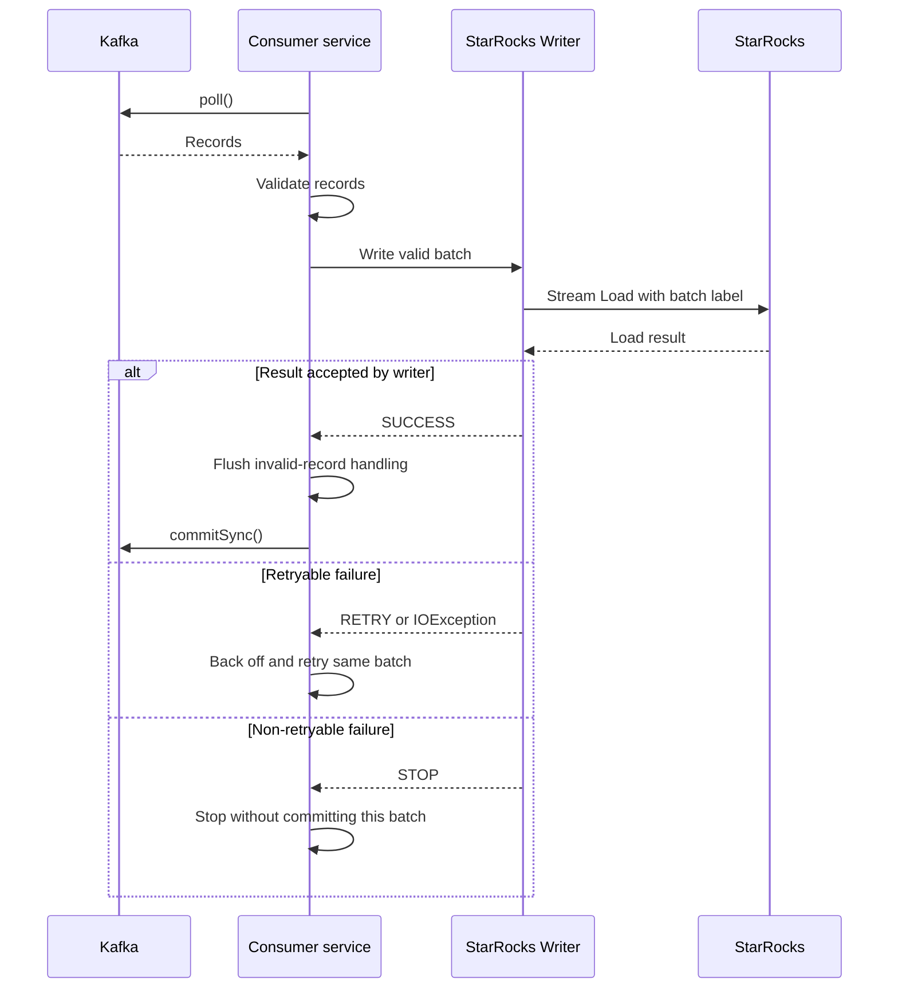

<p align="center">
  
</p>

<p align="center">
  <strong>A distributed data platform for network-traffic analytics.</strong><br>
  Live ingestion, Parquet archives, historical aggregates, and recovery in one Java project.
</p>

<p align="center">
  <a href="https://github.com/ParsaNasirii/pana-big-data/actions/workflows/ci.yml"></a>
  <a href="pom.xml"></a>
  <a href="deploy/ansible/inventory/group_vars/kafka/vars.yml"></a>
  <a href="deploy/ansible/inventory/group_vars/starrocks/vars.yml"></a>
  <a href="apps/cube-maker/pom.xml"></a>
  <a href="deploy/helm/README.md"></a>
</p>

<p align="center">
  <a href="#architecture">Architecture</a> ·
  <a href="#data-model">Data model</a> ·
  <a href="#data-paths">Data paths</a> ·
  <a href="#quick-start">Quick start</a> ·
  <a href="#deployment">Deployment</a> ·
  <a href="#analytics-api">API</a> ·
  <a href="#reliability-and-boundaries">Reliability</a>
</p>

---

## Overview

Pana Big Data follows network-flow records through their lifecycle: consume
Avro events from Kafka, make them queryable in StarRocks, preserve them as
Parquet on HDFS, and turn archived data into analytical aggregates with Spark.
A separate backfill job can restore an archived time window into the main
StarRocks table.

The same dataset supports questions such as **which IPs consume the most
bandwidth, which protocols dominate traffic, and which hosts communicate**—with
raw-record and aggregate query paths exposed through a REST API and Grafana.

### One dataset, two kinds of questions

Network operations need both a detailed view of recent activity and a compact
view of traffic over time. An investigation may start with a particular IP and
its connections; capacity analysis may start with hourly totals and the busiest
hosts or protocols.

The project uses a **Lambda-style architecture** to support these different
access patterns:

- **Live path:** Kafka → StarRocks → API. Keep individual records available for
  detailed SQL analysis as ingestion progresses.
- **Batch path:** Kafka → HDFS → Spark → PostgreSQL → API. Preserve the archive
  and precompute hourly summaries for repeated historical queries.
- **Recovery path:** HDFS → StarRocks. Restore a selected archive window when
  records are missing from the analytical store.

The paths share a source topic but use separate consumer groups. Their progress
and failure states are independent. The API exposes both results explicitly;
it does not merge them into a single automatically reconciled answer.

| Capability | Implementation |
| --- | --- |
| **Stream and query** | Kafka consumers, shared validation, batched StarRocks Stream Load. |
| **Archive and aggregate** | Hourly Parquet on HDFS; Spark jobs write analytical cubes to PostgreSQL. |
| **Restore a time window** | Stage archived rows, then replace the requested window in `netflow_raw`. |
| **Operate and observe** | Ansible roles, Helm charts, application metrics, Prometheus alerts, and Grafana dashboards. |

## Architecture

[](docs/assets/architecture.svg)

<p align="center"><sub>Live analytics · Hourly aggregates · Archive recovery<br>Open the diagram to view it at full size.</sub></p>

**Runtime boundary:** Ansible provisions Kafka and StarRocks on hosts. Helm
deploys the applications, Schema Registry, Spark, PostgreSQL, and monitoring
on Kubernetes. An existing **HDFS cluster and Kubernetes cluster** are required;
the `hdfs-client` chart supplies client configuration only.

## Data model

**NetFlow describes the workload, not just a table name.** Records describe
network flows: who communicated, over which ports and protocols, and how much
traffic was exchanged. This repository starts at Kafka consumption; a production
event producer and its dataset are supplied separately.

| Field group | Representative fields | Used for |
| --- | --- | --- |
| Endpoints | `IPV4_SRC_ADDR`, `IPV4_DST_ADDR`, `L4_SRC_PORT`, `L4_DST_PORT` | IP summaries and connection analysis |
| Protocols | `PROTOCOL`, `L7_PROTO` | Protocol inspection; current rankings group by `PROTOCOL` |
| Volume | `IN_BYTES`, `OUT_BYTES`, `IN_PKTS`, `OUT_PKTS` | Traffic totals and rankings |
| Flow details | Duration, TCP flags, TTL, DNS, ICMP, and FTP fields | Validation and raw-record inspection |
| Pipeline time | Kafka record timestamp | Archive directories, analytical windows, and daily partitions |

Consumers deserialize Avro using **Schema Registry**. The Parquet Writer extends
the incoming schema with a string `KAFKA_TIMESTAMP`; the StarRocks Writer stores
the Kafka record timestamp as epoch milliseconds in `KAFKA_TIMESTAMP_MS`.
These timestamps are not the time at which the database finished loading a row.
Backfill converts the archived timestamp back to milliseconds.

The StarRocks [table definition](apps/starrocks-writer/init.sql) derives
`KAFKA_DAY` from that timestamp, partitions by day, and distributes rows by
source IP. Its duplicate-key model retains individual records. PostgreSQL
stores three kinds of hourly cubes: **IP traffic, protocol usage, and IP-to-IP
connections**; see the [aggregate tables](deploy/helm/infrastructure/postgres/files/postgres-tables.sql).

Schema Registry provides the serialization contract; it does not migrate SQL
tables or make every schema change compatible. For example, the Parquet Writer
rejects a structural schema change while it is writing its current set of files.

## Data paths

### 01 · Live analytics

The StarRocks Writer consumes Kafka records, applies shared validation, maps
valid records to rows, and sends CSV batches through HTTP Stream Load. Load
labels are reused when retrying a pending batch within the same process.
The shared consumer commits Kafka offsets after the writer returns `SUCCESS`.

The acceptance and commit boundary for a non-empty batch is:



The current writer accepts `Success`, `Publish Timeout`, and an existing label
whose job is `FINISHED`. A publish timeout can mean the transaction is committed
before its rows are queryable. **Kafka offset commit and StarRocks visibility
are separate events.** See [reliability and boundaries](#reliability-and-boundaries).

### 02 · Historical analytics

The Parquet Writer consumes Kafka through its own consumer group and archives
records in hourly HDFS directories. Cube Maker reads the archive with Spark
and writes hourly traffic, protocol, and connection aggregates to PostgreSQL.
The API exposes these precomputed results separately from raw StarRocks queries.

Files are first written under `_temporary` and published into their final
directory when they rotate. The Parquet Writer returns `SUCCESS_NO_COMMIT`
while files remain open. During normal rotation, successfully publishing the
open files allows the shared consumer to commit its offsets. Shutdown can
publish remaining files after the consumer closes, leaving those records
eligible for replay. Rotation depends on configured size and time thresholds.
Cube Maker tracks processed directories to avoid processing the same completed
directory on every run.

With the current [Cube Maker defaults](deploy/helm/apps/cube-maker/values.yaml),
an hourly directory becomes eligible two hours after its hour ends, and the
CronJob runs every six hours. Scheduling, file rotation, and processing time
therefore make aggregate freshness different from live ingestion freshness.

Parquet Maintenance compacts small files, recovers interrupted compactions, and
removes stale temporary files, abandoned staging directories, and expired locks.
It does **not** implement age-based retention of archived traffic.

### 03 · Archive recovery

Backfill discovers Parquet files for a configured `[start, end)` window and
asks StarRocks `FILES()` to load them into a staging table. Java orchestrates
file discovery and SQL; the archived rows are read by StarRocks.

Strict loading and a `VISIBLE` result are checked before an `INSERT OVERWRITE`
replaces the affected daily partitions. Rows outside the requested window in
those partitions are carried forward. The staging table is then cleaned up.
An empty window fails before replacing the main table's data.

Rerunning a complete, unchanged archive window **replaces that window** instead
of appending another copy. Pause the live Writer during restoration and read
the [archive completeness limitation](#reliability-and-boundaries) first.

### Why keep these components separate?

| Choice | What it provides | What it costs |
| --- | --- | --- |
| Independent Kafka consumers | Raw analytics and archiving can progress separately | Two offset positions and potentially different freshness |
| StarRocks for raw records | SQL over detailed, column-oriented data | A separate replicated database to operate |
| HDFS with Parquet | A compressed archive for batch computation and recovery | File rotation, small-file maintenance, and archive-completeness checks |
| Spark with PostgreSQL cubes | Aggregation runs ahead of API requests | Scheduled processing lag and loss of per-record detail in the summaries |
| A separate Backfill Job | An explicit recovery window and lifecycle | Coordination with the live Writer during replacement |
| Ansible plus Helm | Host services and Kubernetes workloads described in code | Environment-specific inventory, storage, credentials, and image setup |

Kafka partitions, consumer replicas, Spark workers, and StarRocks backends are
separate capacity controls. Increasing one does not remove bottlenecks in the
others. The repository contains deployment settings and metrics, rather than
a measured throughput guarantee or automatic end-to-end scaling policy.

## Technology stack

Versions below come from the repository's POMs and deployment configuration.

| Layer | Technology | Role |
| --- | --- | --- |
| Applications | Java 17 · Maven | Ingestion, recovery, and shared libraries |
| Event streaming | Kafka 3.7.2 · Schema Registry 8.0.2 | Event transport and Avro schemas |
| Raw analytics | StarRocks 4.0.12 | Columnar storage and SQL queries |
| Archive | Hadoop client 3.3.6 · Avro 1.12.0 · Parquet 1.15.2 | HDFS access and archive formats |
| Batch compute | Spark 4.1.1 | Historical aggregates and compaction |
| Aggregate storage | PostgreSQL 17 / Spilo | Persisted analytical cubes |
| API | Spring Boot 3.5.16 · OpenAPI | Raw and aggregate query endpoints |
| Observability | Micrometer · Prometheus · Grafana | Metrics, alerts, and dashboards |
| Delivery | Ansible · Helm · Jib · GitHub Actions | Provisioning, packaging, and verification |

## Quick start

### Build and run the tests

You need **JDK 17**, **Maven**, and a working **Docker daemon**. Integration tests
start their own containers and local HDFS MiniDFSCluster instances; an existing
deployment is not needed for the test suite. The first run downloads public
dependencies and images.

Clone the repository, then run the verification from its root:

```bash
git clone https://github.com/ParsaNasirii/pana-big-data.git
cd pana-big-data

java -version
mvn -version
docker info

mvn --batch-mode --no-transfer-progress \
  --settings deploy/pipeline/maven-settings.xml \
  --global-settings deploy/pipeline/maven-settings.xml \
  verify
```

Run the reactor serially as shown to limit simultaneous test services. Both
settings arguments keep machine-specific Maven mirrors and credentials out of
the build. Dependencies use Maven Central and the public Confluent repository.

<details>
<summary><strong>Compile without tests or format the Java source</strong></summary>

```bash
# Compile and package without executing tests.
mvn --settings deploy/pipeline/maven-settings.xml \
  --global-settings deploy/pipeline/maven-settings.xml \
  -DskipTests package

# Apply the repository's Java formatting rules.
mvn --settings deploy/pipeline/maven-settings.xml \
  --global-settings deploy/pipeline/maven-settings.xml \
  spotless:apply
```

</details>

### Build an application image

Install the shared reactor artifacts, then build a selected application with Jib:

```bash
mvn --settings deploy/pipeline/maven-settings.xml \
  --global-settings deploy/pipeline/maven-settings.xml \
  -DskipTests install

mvn --settings deploy/pipeline/maven-settings.xml \
  --global-settings deploy/pipeline/maven-settings.xml \
  -pl apps/starrocks-writer jib:dockerBuild \
  -Dimage.registry=pana-big-data -Dimage.tag=dev
```

This produces `pana-big-data/starrocks-writer:dev` in your local Docker daemon.
Build each application module separately. To publish an image, authenticate with
your registry, use `jib:build`, and set `image.registry` to your own namespace,
for example `ghcr.io/YOUR_GITHUB_USER/pana-big-data`.

The chart defaults under `ghcr.io/your-github-user/pana-big-data/` are
**placeholders for your own images**, not downloadable application releases.

## Deployment

Start with the dedicated guides; they document the required inputs and commands.

| Step | Configure | Guide |
| --- | --- | --- |
| **1. Hosts** | Kafka KRaft, StarRocks FE/BE, disks, SSH, cluster ID, and Vault | [Ansible guide](deploy/ansible/README.md) |
| **2. Cluster services** | HDFS client settings, Schema Registry, PostgreSQL, Spark, and monitoring | [Helm guide](deploy/helm/README.md) |
| **3. Applications** | Published images, endpoints, ConfigMaps, and existing Secrets | [Application charts](deploy/helm/apps) |
| **4. Input data** | An external Avro event producer and registered schemas | [Archive schema](apps/parquet-writer/src/main/java/io/github/panabigdata/parquet/NetFlowParquetSchema.java) |

The example topology uses documentation addresses `192.0.2.11`–`192.0.2.14`.
Replace them with your own hosts. The example namespace and StarRocks database
are `panabigdata`; the HDFS nameservice is `netflow`.

Applications using the shared configuration library read
`/app/config/application.properties`, mounted from ConfigMaps. Database
credentials come from Kubernetes Secrets. Keep environment overrides in ignored
`*.local.yaml` files and real Ansible secrets in encrypted, ignored `vault.yml`
files. Keep the example `Asia/Tehran` time-zone settings consistent across the
writers, Spark jobs, database sessions, and API.

> **Backfill is an on-demand operation.** Set `backfill.start` and `backfill.end`
> to ISO-8601 timestamps with a time-zone offset, plus an image tag and the existing Secret in the
> [Backfill chart](deploy/helm/apps/starrocks-backfill/values.yaml).
> Stop the Writer for the full restore. The chart creates a Helm hook Job;
> a subsequent upgrade recreates it for another run.

## Analytics API

Both query paths expose the same four endpoint names:

- **`/api/starrocks`** reads raw records from StarRocks.
- **`/api/spark`** reads Spark-produced aggregates from PostgreSQL; it does not
  start a Spark job for each request.

| GET endpoint | Purpose | Parameters |
| --- | --- | --- |
| `/traffic-summary` | Traffic totals for an IP | `ip`, `start`, `end` |
| `/connections` | Paginated connections for an IP | `ip`, `start`, `end`, `page`, `size`, `sort` |
| `/top-ips` | IPs ranked by traffic | `start`, `end`, `limit` |
| `/top-protocols` | Protocol usage ranking | `start`, `end`, `limit` |

After deploying or forwarding the API to port `8080`, replace the sample time
window and IP with values present in your dataset:

```bash
curl --get 'http://localhost:8080/api/starrocks/traffic-summary' \
  --data-urlencode 'ip=198.51.100.10' \
  --data-urlencode 'start=2026-01-01T10:00:00+03:30' \
  --data-urlencode 'end=2026-01-01T11:00:00+03:30'

curl --get 'http://localhost:8080/api/spark/top-protocols' \
  --data-urlencode 'start=2026-01-01T10:00:00+03:30' \
  --data-urlencode 'end=2026-01-01T11:00:00+03:30' \
  --data-urlencode 'limit=5'
```

Use ISO-8601 timestamps with an offset; `--data-urlencode` preserves the `+`
in the time zone. API queries include both time endpoints, while Backfill uses
an exclusive end. Aggregate time filters apply to hourly bucket starts.

The two API families are **not interchangeable**: raw `top-ips` ranks source IPs,
while aggregate IP cubes include source and destination roles. Raw
`top-protocols` ranks record counts; the aggregate endpoint ranks total bytes.
Top-list responses also differ: StarRocks returns pages, Spark returns lists.

### Why can the two paths return different answers?

Start by checking **meaning**, then **freshness**. A raw record count and an
hourly byte total do not become equivalent just because both endpoints are
called `top-protocols`.

For a meaningful comparison:

1. Match the metric, source/destination roles, filters, time zone, and window
   boundaries. Use complete hour buckets when comparing with hourly cubes.
2. Check that both consumer groups have processed the intended Kafka data,
   that Parquet files have been published, and that Cube Maker completed those
   directories. The live and batch paths reach these points at different times.
3. Investigate rejected records, retries that replay data, late archive files,
   and incomplete recovery windows before interpreting a discrepancy as a
   database error.

The current system does not automatically prove convergence or choose one
answer as authoritative. Waiting for a batch run alone does not fix differing
query definitions or missing/duplicated input.

Endpoint definitions: [StarRocks controller](apps/api-service/src/main/java/io/github/panabigdata/api/controller/StarRocksController.java)
and [Spark controller](apps/api-service/src/main/java/io/github/panabigdata/api/controller/SparkController.java).

## Observability

The [monitoring chart](deploy/helm/infrastructure/monitoring-stack) packages
Prometheus, Pushgateway, Grafana, and node-exporter. Its **11 provisioned
dashboards** cover infrastructure, application pipelines, and analytics.
Kafka JMX metrics and application metrics connect ingestion activity, retries,
pending work, and processing times to the underlying services.

Operational questions include whether writes are being accepted, archives are
rotating, cube runs finish successfully, and host resources can sustain the
workload. Analytics dashboards answer traffic questions; operational dashboards
help explain why those answers may be delayed or incomplete.

Explore the [dashboards](deploy/helm/infrastructure/monitoring-stack/dashboards),
[scrape configuration](deploy/helm/infrastructure/monitoring-stack/prometheus/prometheus.yml),
and [alert rules](deploy/helm/infrastructure/monitoring-stack/prometheus/alerts.yml).

## Testing and CI

The test suite combines unit tests with integration tests using Testcontainers,
HDFS MiniDFSCluster, and local Spark. Kafka/Schema Registry, StarRocks loading
and backfill, and PostgreSQL repositories are exercised with real containers.
The StarRocks API repository tests use H2; not every database query is tested
against its deployment engine. Test images can also differ from deployment
versions—for example, Kafka tests use 3.8.0 and PostgreSQL tests use 15.

| Local verification · 2026-10-10 | Result |
| --- | --- |
| Full Maven reactor | **12 modules built successfully** |
| Automated tests | **265 passed · 0 failures · 0 errors · 0 skipped** |
| Helm lint and template rendering | **11 charts · 50 resources validated** |
| Ansible configuration | **Syntax and inventory checks passed** |

These are recorded local results for the current source snapshot, not a live
cluster certification or a performance benchmark. The
[GitHub Actions workflow](.github/workflows/ci.yml) runs `mvn verify` on pushes,
pull requests, and manual invocations. Deployment and image publishing are
separate operator steps.

## Reliability and boundaries

The implementation makes the following trade-offs explicit:

| Area | Current behavior |
| --- | --- |
| **Delivery semantics** | Kafka offsets and StarRocks transactions are not atomic together. A crash after a load succeeds but before the offset commit can replay records. This is not an end-to-end exactly-once guarantee. |
| **Invalid records** | Shared validation filters invalid records before writing. Configure `dlq.kafka.topic` to route them to a dead-letter topic; otherwise the handler drops them. |
| **Table model** | `netflow_raw` uses `DUPLICATE KEY (KAFKA_TIMESTAMP_MS)`. The key is a sort key, not a uniqueness constraint. |
| **Storage layout** | Daily partitions, hash distribution on source IP, three replicas, and `zstd(1)` compression. The main DDL leaves bucket count to StarRocks; there is no automatic table retention policy. |
| **Archive completeness** | Discovery skips missing hourly directories. An incomplete archive can replace a window with incomplete data. Restore only from a complete, stable archive. |
| **Concurrent writes** | Backfill requires the Writer to remain paused; the application does not acquire a global lock against live inserts. |
| **Schema compatibility** | Backfill uses `BY NAME` with an archive projection. Unexpected extra archive columns can fail the load; arbitrary schema evolution is not supported. |
| **Late archive files** | Cube Maker skips directories already marked processed. New files arriving in those directories are not automatically aggregated. |
| **Deployment defaults** | Example addresses, image namespaces, and Secrets need configuration. Kafka PLAINTEXT and the supplied lab access settings require review before exposing services. |
| **Application rollout** | Both Writer Deployments use `Recreate`. Updating them can interrupt ingestion; zero-downtime rollout is not implemented. |

The source of truth for the table is [init.sql](apps/starrocks-writer/init.sql).
Changing `CREATE TABLE IF NOT EXISTS` does not migrate an existing table.

## Project map

```text
pana-big-data/
├── apps/
│   ├── starrocks-writer/       Kafka → StarRocks
│   ├── parquet-writer/         Kafka → HDFS Parquet
│   ├── starrocks-backfill/     HDFS → main StarRocks table
│   ├── cube-maker/             Spark → PostgreSQL aggregates
│   ├── parquet-maintenance/    Compaction and temporary-file cleanup
│   ├── api-service/            REST analytics
│   └── shared/                 Configuration, HDFS, Kafka, metrics
├── deploy/
│   ├── ansible/                Kafka and StarRocks provisioning
│   ├── helm/                   Application and infrastructure charts
│   └── pipeline/               Public Maven settings
├── docs/assets/                README artwork
├── .github/workflows/          Build and test automation
└── pom.xml                     Maven reactor and shared versions
```

<details>
<summary><strong>Where to start reading the code</strong></summary>

- **Ingestion:** [Writer entry point](apps/starrocks-writer/src/main/java/io/github/panabigdata/Main.java)
  → [shared consumer loop](apps/shared/kafka-consumer-service/src/main/java/io/github/panabigdata/kafka/KafkaConsumerService.java)
  → [Writer service](apps/starrocks-writer/src/main/java/io/github/panabigdata/StarRocksWriterService.java)
  → [Stream Load client](apps/starrocks-writer/src/main/java/io/github/panabigdata/StarRocksStreamLoadClient.java).
- **Archive:** [Parquet Writer entry point](apps/parquet-writer/src/main/java/io/github/panabigdata/Main.java)
  and [archive schema](apps/parquet-writer/src/main/java/io/github/panabigdata/parquet/NetFlowParquetSchema.java).
- **Recovery:** [Backfill orchestration](apps/starrocks-backfill/src/main/java/io/github/panabigdata/backfill/Backfill.java)
  and [Backfill configuration](apps/starrocks-backfill/src/main/java/io/github/panabigdata/backfill/BackfillConfig.java).
- **Batch analytics:** [Cube Maker entry point](apps/cube-maker/src/main/java/io/github/panabigdata/Main.java).
- **Storage:** [StarRocks table definition](apps/starrocks-writer/init.sql).

</details>

---

<p align="center">
  <strong>Pana Big Data</strong><br>
  Follow the data—from the first event to the recovered archive.
</p>
